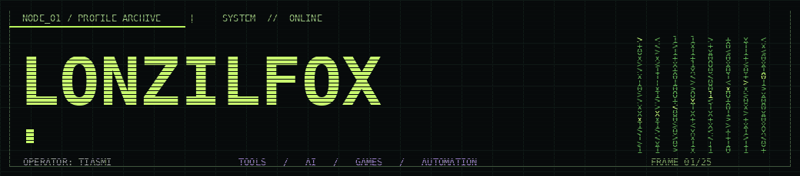
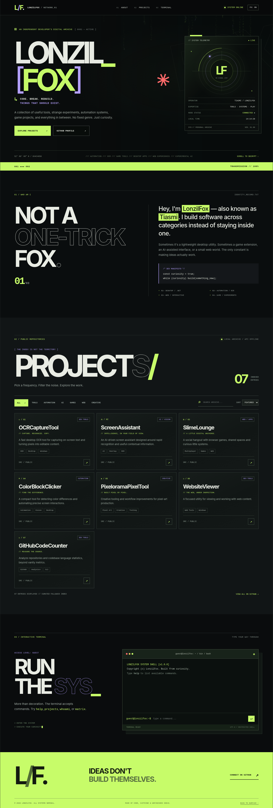

<div align="center">
  

  # LONZILFOX // PERSONAL NETWORK
  **Deconstructed cyberpunk portfolio · GitHub Pages · Live project archive**

  [](https://lonzilfox.github.io/)
  [](https://github.com/LonzilFox)
</div>

---

## `01 // About the project`

The source code for **LonzilFox's personal GitHub Pages website**: a developer portfolio with a hacker terminal aesthetic, brutalist/deconstructed typography, realtime GitHub repository discovery and handcrafted project descriptions.

Includes:

- Animated matrix-style code rain, orbital system display, scanlines and glitch headers.
- Working terminal commands: `help`, `whoami`, `projects`, `github`, `status`, `matrix`, `date`, `clear`.
- Projects indexed from the **public GitHub REST API** (read-only, no API token).
- Live search, category filters, sort modes and mobile-friendly cards.
- Offline / API-limited fallback index, with clear sync status.
- `FX: ON/OFF` switch and reduced-motion support.
- Plain HTML, CSS and JavaScript; **no npm, build, or framework required**.

> The fallback project list is curated rather than verified live. When the GitHub API is available, the website displays the actual public repositories instead.



## `02 // Repository layout`

```text
lonzilfox.github.io/
├── index.html               # GitHub Pages entry
├── README.md                # README on the WEBSITE repository
├── .nojekyll                # Publish files without Jekyll processing
├── .gitignore
├── preview_local.bat        # Windows local preview
├── publish_site.bat         # GitHub CLI publishing helper
└── assets/
    ├── style.css            # Layout / animation / responsive styles
    ├── main.js              # UI logic / terminal / live GitHub sync
    ├── config.js            # Featured projects & category overrides
    ├── favicon.svg
    ├── profile-banner.gif   # Animated README banner
    ├── preview.png          # Desktop screenshot
    └── preview-mobile.png   # Mobile screenshot
```

## `03 // Deploy to GitHub Pages`

1. Create a **public** GitHub repository named **`lonzilfox.github.io`** in the `LonzilFox` account.
2. Upload the **contents** of this directory to the repository root (not the parent packaging directory).
3. Open **Settings → Pages → Build and deployment**.
4. Select **Deploy from a branch** → `main` → `/ (root)` → **Save**.
5. Open **https://lonzilfox.github.io/** once GitHub finishes publishing.

Or use `publish_site.bat` on Windows when Git and GitHub CLI (`gh auth login`) are set up. It does not force push.

### Run locally

Run `preview_local.bat` (Python required) or `python -m http.server 8765` in this folder and visit `http://localhost:8765/`. You can also open `index.html` directly, although an HTTP server is preferable.

## `04 // Manage your project categories`

Edit **[`assets/config.js`](./assets/config.js)**. Each entry uses the **exact repository name** as its key. The GitHub API provides the list of public repositories and your overrides supply their category, editorial text, tags and featured order.

```js
'ColorBlockClicker': {
  category: 'automation', // tools | automation | ai | game | web | creative
  also: ['tools'],        // optional secondary category / filter
  featured: 4,
  tagline: 'FIND THE DIFFERENCE.',
  description: 'A compact tool for detecting color differences.',
  tags: ['Automation', 'Vision', 'Desktop']
}
```

Repositories without an override are automatically classified using their names, descriptions and GitHub Topics. To improve classification, set GitHub Topics on your repos or add explicit overrides.

**Data limitations:** Only public repositories can appear. GitHub may rate-limit unauthenticated requests; the page then uses its bundled fallback and reports that status. The site does not access private repositories and does not store any tokens.

## `05 // GitHub profile README`

The file for your **actual GitHub personal profile** is in the sibling directory `../LonzilFox/README.md` of the downloadable package. GitHub treats that as a **different repository** (`LonzilFox/LonzilFox`). The two repositories are separated intentionally:

| Repository | What appears |
|:--|:--|
| `LonzilFox/lonzilfox.github.io` | Public website + this project's README |
| `LonzilFox/LonzilFox` | Animated README displayed on your GitHub **user profile** |

The profile README links to your portfolio and references the animated GIF directly from this website repository.

---

<div align="center"><code>DESIGNED TO DISRUPT / BUILT TO WORK</code></div>
